  

## About Me

Hello! I'm **Woohyuck Jeong**, an AI Agent Developer at **Didim**, building intelligent agentic systems and optimizing language model deployments.

<table>
  <tr><td><b>Focus</b></td><td>AI Agent Development · LLM Serving (vLLM, Ollama) · Model Fine-Tuning</td></tr>
  <tr><td><b>Experience</b></td><td>Backend Dev · DB Design · RAG Pipelines · AI Services (MCP &amp; Tool Use)</td></tr>
  <tr><td><b>Background</b></td><td>Finance Accounting &amp; Data Science</td></tr>
</table>

---

## GitHub Stats

  

---

## Studying
- Agent System Design (MCP, Tool Use, Multi-Agent Orchestration)
- RAG Pipeline & Knowledge Graph (Graphiti, Ontology)

## Featured Projects
- [**midas-touch**](https://github.com/Jacob-9909/midas-touch): AI financial assistant that cites its sources — scam message checks, deterministic tax calculation, and housing subscription advice with LangGraph and GraphRAG. [Live demo](https://midas-touch-five.vercel.app)
- [**kaspflow**](https://github.com/Jacob-9909/kaspflow): Real-time crypto data pipeline — Binance → Kafka → Spark Structured Streaming → PostgreSQL → FastAPI → React, with backtesting. [Live demo](https://bit-kaspflow.duckdns.org)
- [**tablefold**](https://github.com/Jacob-9909/tablefold): Folds a wide physical schema into a few logical models an LLM can read in one shot, then expands the SQL back.
- [**OpenTrading**](https://github.com/Jacob-9909/OpenTrading): LangGraph multi-agent trading system with a risk engine and multi-position management.

## Open Source Contributions
- [hmmhmmhm/daiso-mcp](https://github.com/hmmhmmhm/daiso-mcp/pulls?q=is%3Apr+author%3AJacob-9909+is%3Amerged) — 3 merged PRs
- [mvschwarz/openrig](https://github.com/mvschwarz/openrig/pulls?q=is%3Apr+author%3AJacob-9909) · [DavidHDev/react-bits](https://github.com/DavidHDev/react-bits/pulls?q=is%3Apr+author%3AJacob-9909) · [t8y2/dbx](https://github.com/t8y2/dbx/pulls?q=is%3Apr+author%3AJacob-9909) · [tunnetio/Tunnet](https://github.com/tunnetio/Tunnet/pulls?q=is%3Apr+author%3AJacob-9909) · [vorssaint/vorssaint-utils](https://github.com/vorssaint/vorssaint-utils/pulls?q=is%3Apr+author%3AJacob-9909) — merged bug fixes

---

## Languages and Tools

<table>
  <tr>
    <td valign="middle"><b>Languages</b></td>
    <td></td>
  </tr>
  <tr>
    <td valign="middle"><b>ML &amp; Automation</b></td>
    <td></td>
  </tr>
  <tr>
    <td valign="middle"><b>Backend</b></td>
    <td></td>
  </tr>
  <tr>
    <td valign="middle"><b>LLM Frameworks</b></td>
    <td>   </td>
  </tr>
  <tr>
    <td valign="middle"><b>Data &amp; Monitoring</b></td>
    <td></td>
  </tr>
  <tr>
    <td valign="middle"><b>DevOps &amp; Cloud</b></td>
    <td></td>
  </tr>
  <tr>
    <td valign="middle"><b>Productivity</b></td>
    <td></td>
  </tr>
</table>

---

 

  
  
  

